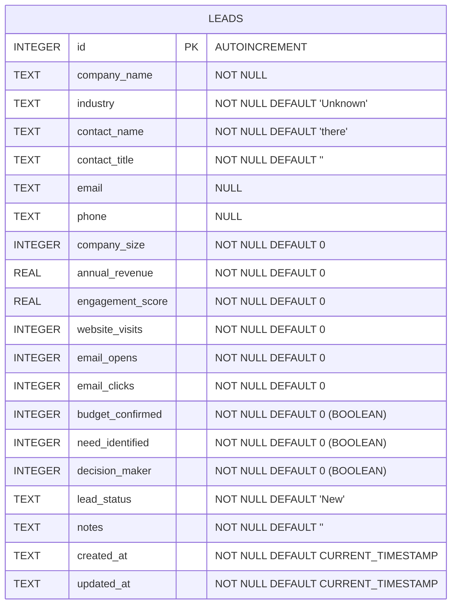

# ER Diagram - SalesGenie AI Database

## Database Overview
**Database:** SQLite (`data/salesgenie.db`)  
**Schema Version:** 1.0  
**Tables:** 1 (leads)

## Entity Relationship Diagram



## Table Details

### LEADS Table
Primary entity storing all lead/prospect information.

| Column | Data Type | Constraints | Description |
|--------|-----------|-------------|-------------|
| `id` | INTEGER | PRIMARY KEY, AUTOINCREMENT | Unique identifier for each lead |
| `company_name` | TEXT | NOT NULL | Name of the prospect company |
| `industry` | TEXT | NOT NULL, DEFAULT 'Unknown' | Industry sector |
| `contact_name` | TEXT | NOT NULL, DEFAULT 'there' | Primary contact person |
| `contact_title` | TEXT | NOT NULL, DEFAULT '' | Contact's job title |
| `email` | TEXT | NULL | Contact email address |
| `phone` | TEXT | NULL | Contact phone number |
| `company_size` | INTEGER | NOT NULL, DEFAULT 0 | Number of employees |
| `annual_revenue` | REAL | NOT NULL, DEFAULT 0 | Annual revenue in currency units |
| `engagement_score` | REAL | NOT NULL, DEFAULT 0 | Calculated engagement score (0-100) |
| `website_visits` | INTEGER | NOT NULL, DEFAULT 0 | Count of website visits |
| `email_opens` | INTEGER | NOT NULL, DEFAULT 0 | Count of email opens |
| `email_clicks` | INTEGER | NOT NULL, DEFAULT 0 | Count of email clicks |
| `budget_confirmed` | INTEGER | NOT NULL, DEFAULT 0 | Boolean flag (0=False, 1=True) |
| `need_identified` | INTEGER | NOT NULL, DEFAULT 0 | Boolean flag (0=False, 1=True) |
| `decision_maker` | INTEGER | NOT NULL, DEFAULT 0 | Boolean flag (0=False, 1=True) |
| `lead_status` | TEXT | NOT NULL, DEFAULT 'New' | Status: New, Contacted, Qualified, Proposal, Negotiation, Won, Lost |
| `notes` | TEXT | NOT NULL, DEFAULT '' | Free-form notes and business needs |
| `created_at` | TEXT | NOT NULL, DEFAULT CURRENT_TIMESTAMP | Record creation timestamp |
| `updated_at` | TEXT | NOT NULL, DEFAULT CURRENT_TIMESTAMP | Last modification timestamp |

## Relationships
Currently a single-table schema with no foreign key relationships. All data is denormalized in the `leads` table.

## Business Rules
- `company_name` is required for lead creation
- Boolean fields (`budget_confirmed`, `need_identified`, `decision_maker`) are stored as INTEGER (0/1) and converted to Python bools
- `engagement_score` ranges from 0-100 (enforced by Pydantic schema)
- `lead_status` has predefined values in the UI
- `updated_at` is automatically updated on PATCH operations
- All numeric counters default to 0

## Data Flow
1. **Lead Management** creates/updates/deletes records in `leads` table
2. **Lead Intelligence** reads lead data to generate company analysis
3. **Lead Scoring** reads lead data and applies rules to calculate score
4. **AI Outreach** reads lead data to generate personalized drafts

```text
┌─────────────────────────────────────────────────────────────┐
│                        LEADS TABLE                          │
├─────────────────────────────────────────────────────────────┤
│ PK  id (INTEGER AUTOINCREMENT)                               │
│     company_name, contact_name, email, phone                │
│     industry, company_size, annual_revenue                  │
│     engagement_score, website_visits, email_opens, clicks   │
│     budget_confirmed, need_identified, decision_maker (BOOL)│
│     lead_status, notes                                       │
│     created_at, updated_at (TIMESTAMP)                      │
└─────────────────────────────────────────────────────────────┘
                            │
                            │ Read/Write
                    ┌───────┴───────┐
                ┌───▼───┐   ┌───────▼───────┐
              CRUD    │   │   Intelligence │
             Operations│   │    & Scoring   │
                      │   │   & Outreach   │
                      └───┴───────────────┘
```
