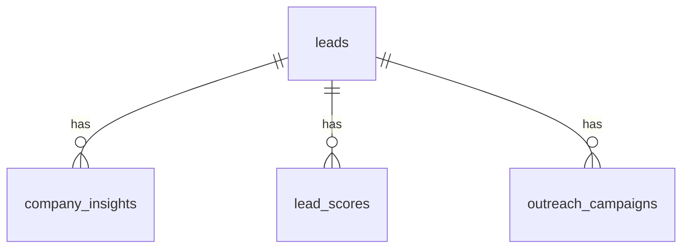

# Database Schema · revision `0001`

## Entity relationship



Each child contains a non-null `lead_id` foreign key to `leads.lead_id` with `ON DELETE CASCADE`. Application relationships additionally declare `delete-orphan`. Timestamps use Python UTC-aware defaults and SQLAlchemy `DateTime(timezone=True)`; SQLite stores datetime without preserving a timezone offset natively, so comparisons should be normalized to UTC.

## 1. `leads`

| Column | Type | Rules |
|---|---|---|
| `lead_id` | integer | primary key |
| `company_name` | varchar(200) | required, indexed |
| `industry` | varchar(100) | optional, indexed |
| `contact_name` | varchar(150) | optional |
| `email` | varchar(254) | optional, unique indexed, normalized to lowercase |
| `phone` | varchar(40) | optional |
| `lead_status` | varchar(30) | required, indexed, API enum `New/Contacted/Qualified/Converted` |
| `company_size` | varchar(30) | optional category |
| `engagement_score` | float | required, check 0–100 |
| `notes` | text | optional |
| `source` | varchar(100) | optional |
| `is_active` | boolean | required |
| `created_at`, `updated_at` | datetime | required; updated timestamp refreshed on ORM updates |

Composite index on `(company_name, contact_name)` accelerates duplicate detection. Case-insensitive company/contact duplicates are handled in the service layer, **not** enforced by a unique composite database constraint; email uniqueness is enforced by a database index as well as the API. For concurrent multi-user production writes, database-level normalized unique constraints should be considered.

## 2. `company_insights`
`insight_id` PK; `lead_id` FK; required `company_summary`, `industry_context`, JSON arrays `potential_needs`, `potential_opportunities`, `observations`, `information_gaps`, `contributing_factors`; `qualification_score` float; `qualification_band` varchar(30); `methodology` text; `created_at`. Indexed by lead and `(lead_id, created_at)` to retrieve latest analysis. Multiple analyses per lead are retained.

## 3. `lead_scores`
`score_id` PK; `lead_id` FK; `score` float, `priority_band` varchar(30); `factors` JSON; `conversion_probability` float nullable; `prediction_mode` varchar(30); `model_version` varchar(100); `recommended_action`, `recommendation_reason`, `recommendation_priority`, `supporting_factors` JSON, `suggested_outreach_goal`; `created_at`. Latest history index `(lead_id, created_at)`. An ML prediction uses probability unit interval **0.0–1.0**, which the UI displays as percentage.

## 4. `outreach_campaigns`
`campaign_id` PK; `lead_id` FK; `email_subject` varchar(300), `email_content` text; `tone`, `communication_goal`, `email_length`, `provider`, `is_mock`, `campaign_status` (always `DRAFT` in current service), `created_at`. History indexed by `(lead_id, created_at)`.

## Migration / local setup

```bat
python -m alembic upgrade head
python -m alembic current
```

The initial revision is `0001_initial_four_modules.py`. Versioning is managed through `alembic_version`. SQLAlchemy supports both SQLite (local default) and PostgreSQL via `DATABASE_URL`. The local driver initializes `PRAGMA foreign_keys=ON` per connection. Database tables are created through migrations; do not silently call `create_all()` in the production app startup. Tests may use `create_all()` on isolated databases for speed and separately verify migration execution.

The larger future eight-table design is not authoritative in this milestone: the supplied requirements specified four concrete active tables and did not name the other four. Future team-approved entities should use new migrations, not invented empty tables now.
